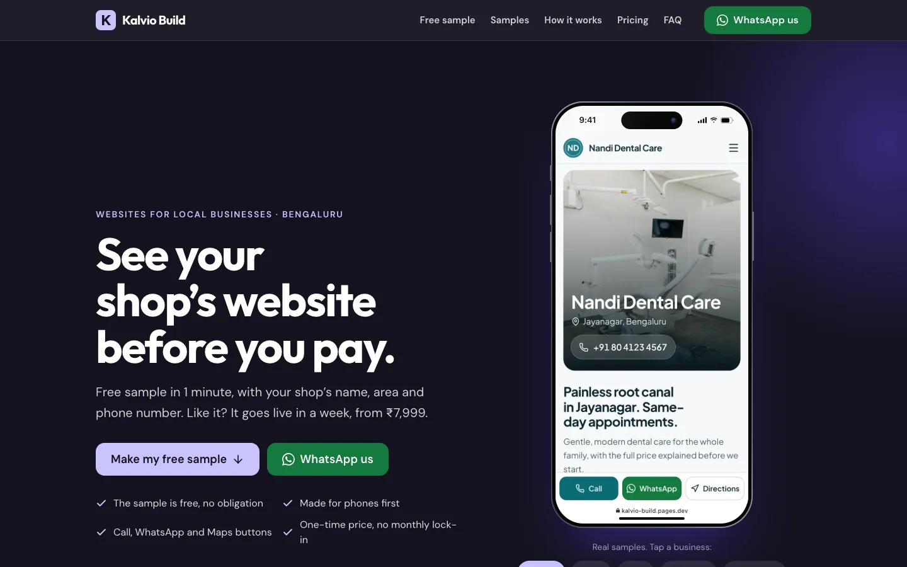

# Kalvio Build

**What:** an agency website that makes a free sample website for any local shop in seconds, with the shop's own name, area and phone number (17 business types, 6 themes).
**For:** local business owners (clinics, salons, gyms, shops, restaurants, US home services) who want to see their website before they pay.
**Run:** `npm install`, then `npm run dev` and open http://localhost:5173 (Node 22).

Live: https://kalvio-build.pages.dev/ · US version with dollar pricing: https://kalvio-build.pages.dev/?region=us ·
US sample: [a plumber in Austin](https://kalvio-build.pages.dev/demo/home_services?name=Peak%20Plumbing%20Co&area=Round%20Rock&city=Austin%2C%20TX&phone=5125550199)



## Pages

- `/`: the agency landing page ("See your shop's website before you pay").
- `/demo/<business-key>?name=…&area=…&phone=…`: a personalised sample for any of 17 business types in any of 6
  themes. The link format is documented in [`docs/DEMO_LINKS.md`](docs/DEMO_LINKS.md).
- `/share?key=…&name=…`: the salesperson's WhatsApp kit for a shop: a picture of their website to send first, a
  10-second video, and a link preview with their name (see `docs/DEMO_LINKS.md`).

## Commands

```
npm install
npm run dev          # http://localhost:5173
npm test             # contrast, presets, link contract
npm run lint
npm run build        # type-check, build, prerender every page
npm run pages:dev    # serve dist/ with the Cloudflare edge function, http://127.0.0.1:8788
```

Copy `.env.example` to `.env` to send landing-page enquiries to Lead Finder (publishable key only).

## Where things live

| what | where |
|---|---|
| Business content (17 presets) | `src/data/businesses/<key>.ts` |
| Themes (colour, type, radius, motion tokens) | `src/themes/` |
| Page sections | `src/sections/` |
| Landing page | `src/pages/Landing.tsx`, `src/landing/` |
| Prices | `src/config/pricing.ts` |
| Contact details | `src/config/site.ts` |
| Festival offer dates | `src/config/seasons.ts` |
| Kannada / Hindi strings | `src/i18n/strings.ts` |
| Real client testimonials (section hidden while empty) | `src/data/testimonials.ts` |
| Photos (self-hosted, credited) | `scripts/stock/manifest.json` → `node scripts/stock/fetch.mjs` → `public/stock/` |
| Edge personalisation for link previews | `functions/demo/[key].ts` |
| Lead Finder enquiry RPC | `supabase/leadfinder/` |
| WhatsApp kit page | `src/pages/Share.tsx`, `src/share/` |
| Share Worker (screenshots, preview images) | `workers/share/`, deploy with `npm run share:deploy` |

Adding a business: write `src/data/businesses/<key>.ts` (copy a similar one), add its photos to the manifest and
fetch them, add it to `src/data/catalog.ts`, then run `npm test`. Regenerate `public/previews/` and `public/og/`
with `node scripts/previews.mjs` and `node scripts/og.mjs`.

Docs: [redesign plan and evidence](docs/REDESIGN_PLAN.md) · [demo links](docs/DEMO_LINKS.md) ·
[deploying on Cloudflare Pages](docs/DEPLOY.md).
